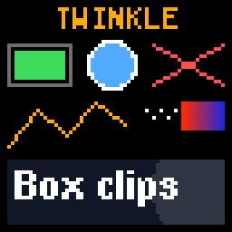
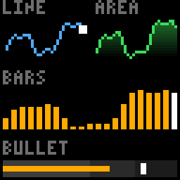
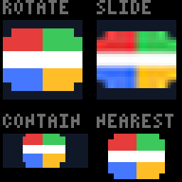
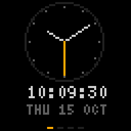

# react-twinkle

React for LED matrices.

`react-twinkle` is a custom React renderer that draws components into a
small RGB canvas, the way [Ink](https://github.com/vadimdemedes/ink) draws
them into a terminal, and streams the frames to a
[WLED](https://kno.wled.ge) panel over the network.

| Primitives                                                           | Charts                                                                   | Pictures                                                                       |
| -------------------------------------------------------------------- | ------------------------------------------------------------------------ | ------------------------------------------------------------------------------ |
|  |  |  |

## About

The goal is to build what an LED panel shows the way a web page is built:
from components, with state, hooks and context, in TypeScript.

- **Components for pixels**: boxes, text, shapes, images and charts,
  placed by pixel. There is no layout engine, on purpose.
- **Frame by frame**: a frame is a function of the component tree, the
  frame number and the time, so a live stream, a preview and a test all
  draw the same thing.
- **Pictures**: JPEG, PNG and GIF decoding, scaling, rotation and
  sub-pixel movement, with alpha kept until it is drawn.
- **Outputs**: DDP over UDP to WLED, PNG, and animated PNG.
- **No fonts included**: the application registers the bitmap fonts it
  draws with.

## Getting started

### Prerequisites

- Node.js 20 or later
- React 18
- An LED matrix running [WLED](https://kno.wled.ge) set up as a 2D
  matrix, if you want to see it on a panel (a PNG works without one)

### Installation

```sh
npm install react-twinkle react
```

### Usage

```tsx
import fs from 'node:fs';
import {Box, DdpOutput, Marquee, Text, registerMonoFont, render, useNow} from 'react-twinkle';

// The library has no fonts: register the ones you draw with.
registerMonoFont('9x15', {
  width: 9,
  height: 15,
  baseline: 11,
  data: fs.readFileSync('font_9x15.raw'),
});

function Clock() {
  const now = useNow();
  return (
    <Text x={32} y={8} font="9x15" align="center" color="#ffaa00">
      {now.toLocaleTimeString('en-GB')}
    </Text>
  );
}

render(
  <>
    <Clock />
    <Box y={40} width={64} height={16} clip>
      <Marquee font="9x15">Hello from React, one pixel at a time</Marquee>
    </Box>
  </>,
  {width: 64, height: 64, fps: 10, output: new DdpOutput('wled.local')},
);
```

[docs/fonts.md](docs/fonts.md) says where to get a font file such as
`font_9x15.raw`, and [docs/outputs.md](docs/outputs.md) how to write a PNG
when there is no panel.

### Example app

[examples/dashboard](examples/dashboard) is a complete app to start from:
a separate package that installs react-twinkle from npm and cycles
through a clock, the weather, this machine's load and scrolling news,
with live data, tests and a mode that restarts on every save.



## Documentation

The [documentation index](docs/README.md) lists every subject. In short:

- [How it works](docs/how-it-works.md)
- [Components and charts](docs/components.md)
- [Pictures](docs/pictures.md)
- [Hooks](docs/hooks.md)
- [Fonts](docs/fonts.md)
- [Outputs](docs/outputs.md)
- [Types](docs/types.md)
- [Developing](docs/developing.md)

## Contributing

`npm run check` runs the linter, the formatter, the type checker and the
tests; [docs/developing.md](docs/developing.md) has the rest.

## License

MIT; see [LICENSE](LICENSE). The licence covers the code only: no font is
part of this project, and each font an application registers comes under
its own terms ([docs/fonts.md](docs/fonts.md)).

## Acknowledgements

- [Ink](https://github.com/vadimdemedes/ink), for the design.
- [embedded-graphics](https://github.com/embedded-graphics/embedded-graphics),
  whose drawing react-twinkle follows to the pixel.
- [WLED](https://kno.wled.ge), which shows the frames.
