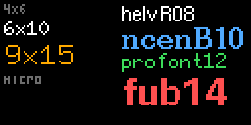

# react-twinkle

React for LED matrices. `react-twinkle` is a custom React renderer that
draws components into a small RGB canvas, the way [Ink](https://github.com/vadimdemedes/ink)
draws them into a terminal, and streams the frames to a
[WLED](https://kno.wled.ge) panel over the network.

| Primitives                                                           | Fonts                                                     | Hooks                                                         |
| -------------------------------------------------------------------- | --------------------------------------------------------- | ------------------------------------------------------------- |
|  |  |  |

These are the library's own pictures of the components in
[examples](examples), four times the panel's size; `npm run screenshots`
draws them again.

```tsx
import fs from 'node:fs';
import {
  Box,
  DdpOutput,
  Marquee,
  Text,
  registerMonoFont,
  registerU8g2Font,
  render,
  useNow,
} from 'react-twinkle';

// The library has no fonts: bring the ones you draw with.
registerMonoFont('9x15', {
  width: 9,
  height: 15,
  baseline: 11,
  data: fs.readFileSync('font_9x15.raw'),
});
registerU8g2Font('helvR08', fs.readFileSync('u8g2_font_helvR08_tf.u8g2font'));

function Clock() {
  const now = useNow();
  return (
    <Text x={32} y={8} font="9x15" align="center" color="#ffaa00">
      {now.toLocaleTimeString('en-GB')}
    </Text>
  );
}

render(
  <>
    <Clock />
    <Box y={40} width={64} height={10} clip>
      <Marquee font="helvR08">Hello from React, one pixel at a time</Marquee>
    </Box>
  </>,
  {width: 64, height: 64, fps: 10, output: new DdpOutput('wled.local')},
);
```

## How it works

It is Ink's design with another surface:

```
  <App />                 your components, hooks, state
     │  react-reconciler
     ▼
  node tree               twinkle-box, twinkle-text, twinkle-rect, …
     │  paint, once a frame
     ▼
  Canvas                  width × height RGB bytes, alpha blended in
     │  output.send(rgb)
     ▼
  DDP over UDP → WLED     or a PNG, an animated PNG, a test's assertion
```

- **The reconciler** (`src/reconciler.ts`) is a `react-reconciler` host
  config, as Ink's is: React builds and updates a tree of plain nodes.
- **A root** (`createRoot`) owns a tree and a canvas. `root.frame({ frame,
now })` draws one frame: it hands the frame to the components that ask
  for it, lets React settle, and paints the tree. Nothing else is hidden
  in it, so a live stream, a preview and a test all draw the same way, and
  a frame is the same every time it is drawn.
- **`render`** is a root on a timer: it draws frame after frame at `fps`
  and gives each to an output.
- **Drawing** is done to the pixel as
  [embedded-graphics](https://github.com/embedded-graphics/embedded-graphics)
  does it (circles, Bresenham lines, stroke alignment, font formats), so a panel
  drawn here matches one drawn by a Rust program using it. That is how
  [duckboard-js](../duckboard-js) reproduces
  [duckboard](../duckboard) frame for frame.

There is no layout engine: a panel has a few thousand pixels, and every
one is placed on purpose. A `Box` gives its children their own
coordinates and, with `clip`, keeps them inside it; `useArea()` tells a
component how much room it has.

## Components

Coordinates are pixels, `(0, 0)` the top-left corner of the box a
component is in. A colour is `"#rrggbb"`, `"#rrggbbaa"` (blended over what
is under it) or `{ r, g, b, a }`.

| Component     | Draws                                                         | Props                                           |
| ------------- | ------------------------------------------------------------- | ----------------------------------------------- |
| `Box`         | a region its children are placed in                           | `x y width height clip background`              |
| `Text`        | one line of text                                              | `x y font color align baseline`                 |
| `Marquee`     | a line centred in its box, scrolling when too wide            | `y font color speed gap baseline`               |
| `Rect`        | a rectangle                                                   | `x y width height fill stroke strokeWidth`      |
| `Circle`      | a circle, by diameter from its top-left                       | `x y diameter fill stroke strokeWidth`          |
| `Line`        | a one-pixel line                                              | `from to color`                                 |
| `Polyline`    | a one-pixel line through points                               | `points color`                                  |
| `Pixels`      | single pixels, one colour or each its own                     | `points color colors`                           |
| `Image`       | RGB or RGBA bytes                                             | `x y width height data alpha`                   |
| `LineChart`   | a series as a line across its box; with `fill`, an area chart | `values color fill dot empty`                   |
| `BarChart`    | a series as bars standing on zero                             | `values color last barWidth gap empty`          |
| `BulletChart` | a value on a scale, over bands, with a marker at a target     | `value target min max ranges color marker band` |

Later siblings are drawn over earlier ones. Each component's props are
exported as a type: `BoxProps`, `TextProps`, and so on.

### Charts

A chart fills the `Box` it is in, so its size is the box's:

```jsx
<Box x={2} y={40} width={60} height={20}>
  <LineChart values={history} color="#50aaff" fill={['#50aaff60', '#50aaff00']} dot="#ffffff" />
</Box>
```


- **`LineChart`** puts the lowest value on the bottom row and the highest
  on the top one. More values than columns are averaged, fewer are joined
  by straight lines. `fill` colours what is under the line, from its first
  colour on the top row to its second on the bottom; `dot` marks the
  latest value.
- **`BarChart`** draws as many bars as fit, `barWidth` wide and `gap`
  apart, centred. The bottom is zero, or the lowest value when one is
  negative, and no bar is under a pixel.
- **`BulletChart`** is Stephen Few's bullet graph: bands to each of
  `ranges` and to `max`, a bar to `value`, a marker at `target`.
- While there are no values a line or bar chart draws a flat line in
  `empty`.

`columns`, `barHeights` and `bulletHeights` are exported for charts of
your own.

## Hooks

| Hook             | Gives                                                                                                 |
| ---------------- | ----------------------------------------------------------------------------------------------------- |
| `useFrame()`     | `{ frame, fps, now, elapsedMs, width, height }` for the frame being drawn                             |
| `useNow()`       | the `Date` the frame is for                                                                           |
| `useElapsedMs()` | milliseconds since the first frame, from the frame number, so animations keep their speed at any rate |
| `useArea()`      | `{ width, height }` of the box the component is in                                                    |
| `useApp()`       | `{ exit(error) }`, to end a `render`                                                                  |

A component that reads the frame is drawn again every frame; one that
does not is left alone until its props or state change. State, effects
and context work as anywhere in React.

## Fonts

react-twinkle reads fonts but has none: fonts are other people's work,
each under its own terms, so the application provides the ones it draws
with and registers them before drawing.

| Call                                                                      | Registers                                                                                                                                                                            |
| ------------------------------------------------------------------------- | ------------------------------------------------------------------------------------------------------------------------------------------------------------------------------------ |
| `registerMonoFont(name, { width, height, baseline, data, glyphsPerRow })` | a fixed-width bitmap font from its glyph image, as embedded-graphics keeps them: `glyphsPerRow` glyphs a row (sixteen unless said), one bit a pixel, ASCII then Latin-1's upper half |
| `registerU8g2Font(name, data)`                                            | a [U8g2](https://github.com/olikraus/u8g2/wiki/fntlistall) font from the bytes of its data, most of them proportional                                                                |
| `registerFont(name, font)`                                                | anything that implements a font: `kind`, `advance(text)`, `inkWidth(text)`, `extent()`, `draw(surface, text, x, y, color)`                                                           |

`font` on `Text` and `Marquee` is the name a font was registered under.
Left out, it is the default font: the first registered, or the one named
with `setDefaultFont(name)`. `fontNames()` lists what is registered,
`measureText(text, font)` measures a line, `getFont(name).extent()` says
how far it rises and falls, and `clearFonts()` forgets them all. Drawing
text before any font is registered is an error that says so.

[docs/fonts.md](docs/fonts.md) says where fonts in these formats are
found, and shows a build step that fetches them:
[duckboard-js](../duckboard-js) downloads the ones it uses when it is
built and keeps none in its repository.

## Outputs

- `new DdpOutput('host[:port]')` sends frames to WLED as DDP (UDP 4048).
- `encodePng(picture)` and `encodeApng(pictures, fps)` make a PNG or an
  animated one from `{ data, width, height }`; `scaleUp(picture, 4)`
  enlarges one first.
- Anything with `send(rgb)` is an output.

Without `render`, draw frames yourself:

```tsx
import fs from 'node:fs';
import {createRoot, encodePng, scaleUp} from 'react-twinkle';

const root = createRoot({width: 64, height: 64});
root.render(<App />);
const canvas = root.frame({frame: 0, now: new Date()});
fs.writeFileSync('frame.png', encodePng(scaleUp({data: canvas.px, width: 64, height: 64}, 4)));
```

## Types

react-twinkle is written in TypeScript and comes with its declarations.
Besides the components' props, it exports the types its functions take
and give:

| Type                                  | Is                                                                      |
| ------------------------------------- | ----------------------------------------------------------------------- |
| `Color`, `ColorLike`                  | `{ r, g, b, a }`, and that or a `"#rrggbb"` string, as a colour prop is |
| `Point`                               | a pixel's place, `[x, y]`                                               |
| `Font`, `MonoFontDescription`         | what `registerFont` and `registerMonoFont` take                         |
| `FrameValue`, `Area`, `App`           | what `useFrame()`, `useArea()` and `useApp()` give                      |
| `RootOptions`, `FrameOptions`         | what `createRoot` and `root.frame` take                                 |
| `RenderOptions`, `Output`, `Instance` | what `render` takes, where it sends frames, and what it gives           |
| `Picture`, `AnimationPart`            | `{ data, width, height }`, and a stored frame of an animated PNG        |

## Developing

```sh
npm install
npm run check          # eslint (Airbnb), prettier, tsc, vitest
npm run build          # dist/index.js and its type declarations
npm run screenshots    # docs/screenshots, from examples/
```

The code is strict TypeScript, with no `any` in it, and follows the
Airbnb style for React and TypeScript, with Prettier formatting it and
typescript-eslint's `no-use-before-define` on for functions, classes and
variables alike. The scripts are TypeScript too, run with `tsx`.
The tests draw with fonts made in `test/support/fonts.ts`; `npm run
screenshots` borrows the fonts duckboard-js has fetched.
It is developed side by side with [duckboard-js](../duckboard-js), which
takes it from `src/` here when the two are checked out next to each other
and is its largest test: every duckboard demo, frame for frame.

MIT licensed; see [LICENSE](LICENSE). No font is part of it.
