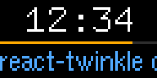

# Hooks

| Hook             | Gives                                                                                                 |
| ---------------- | ----------------------------------------------------------------------------------------------------- |
| `useFrame()`     | `{ frame, fps, now, elapsedMs, width, height }` for the frame being drawn                             |
| `useNow()`       | the `Date` the frame is for                                                                           |
| `useElapsedMs()` | milliseconds since the first frame, from the frame number, so animations keep their speed at any rate |
| `useArea()`      | `{ width, height }` of the box the component is in                                                    |
| `useApp()`       | `{ exit(error) }`, to end a `render`                                                                  |

A component that reads the frame is drawn again every frame; one that
does not is left alone until its props or state change. State, effects
and context work as anywhere in React.

`usePicture` is described in [pictures.md](pictures.md).

---

[Documentation index](README.md) · [Project README](../README.md)
